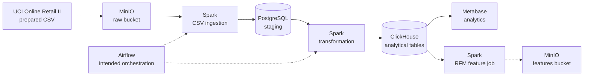

# Online Retail II ETL

A Docker-based **data engineering prototype** for ingesting, transforming, and analyzing transactions from the [UCI Online Retail II dataset](https://archive.ics.uci.edu/dataset/502/online+retail+ii).

The project explores a local data platform using **MinIO, Apache Spark, PostgreSQL, ClickHouse, Apache Airflow, and Metabase**. It includes ingestion and transformation jobs, warehouse schemas, preliminary data-quality checks, and an RFM feature-generation job.

> **Project status: Work in progress.** The infrastructure and pipeline code are present, but the repository is **not yet a working, end-to-end one-command deployment**. See [Known limitations](#known-limitations) before attempting to execute the Airflow workflows.

## Architecture



The **solid arrows** represent the intended main data flow. The **dashed arrows** indicate optional feature generation and orchestration components that require further integration.

| Component | Role |
| --- | --- |
| **MinIO** | S3-compatible storage for raw input and generated features |
| **Apache Spark / PySpark** | CSV ingestion, transformations, and RFM aggregation |
| **PostgreSQL 16** | Transaction-level staging table |
| **ClickHouse 24.4** | Analytical dimension and fact tables |
| **Apache Airflow 2.9.2** | Definitions for scheduled ingestion, transformation, and backfill |
| **Metabase** | Intended exploration and dashboarding layer |
| **Great Expectations** | Preliminary expectation suite and validation script |

## Data source

The project targets **Online Retail II** from the UCI Machine Learning Repository, which covers transactions from a UK-based online retailer between **December 2009 and December 2011**.

- **Source:** [UCI Online Retail II](https://archive.ics.uci.edu/dataset/502/online+retail+ii)
- **Citation:** Chen, D. (2012). *Online Retail II* [Dataset]. UCI Machine Learning Repository. [DOI: 10.24432/C5CG6D](https://doi.org/10.24432/C5CG6D)
- **Original distribution:** an Excel workbook, `online_retail_II.xlsx`
- **Expected pipeline input:** a CSV file named `data/online_retail_ii.csv`

The Spark ingestion job expects these **exact column names**:

| Column | Meaning |
| --- | --- |
| `InvoiceNo` | Invoice identifier |
| `StockCode` | Product identifier |
| `Description` | Product description |
| `Quantity` | Units on the invoice line |
| `InvoiceDate` | Transaction timestamp |
| `UnitPrice` | Price per unit |
| `CustomerID` | Customer identifier |
| `Country` | Customer country |


## Repository layout

```text
.
├── airflow/
│   ├── dags/                    # Ingest, transform, and backfill DAGs
│   ├── Dockerfile
│   └── requirements.txt
├── clickhouse/
│   └── init/                    # Database, dimension, fact, and view SQL
├── minio/
│   └── bucket-bootstrap.sh     # Raw and feature bucket creation
├── postgres/
│   └── initdb/                 # Staging schema and table
├── quality/
│   ├── dq_runner.py            # Experimental quality-check script
│   └── expectations/
├── spark/
│   └── jobs/
│       ├── common_spark.py
│       ├── ingest_csv_to_postgres.py
│       ├── transform_conform_to_clickhouse.py
│       └── compute_features_training_parquet.py
├── tests/                       # Preliminary smoke tests
├── .env.example
├── docker-compose.yml
└── Makefile
```

## Local setup

### Prerequisites

- Docker Engine and the Docker Compose plugin
- Git
- Python 3 with `pandas` and `openpyxl` **only if** preparing the CSV from the UCI Excel file

### 1. Clone and configure

```bash
git clone https://github.com/mehdisn/online-retail-ii-etl.git
cd online-retail-ii-etl
cp .env.example .env
```

Review `.env` before running the containers. It contains **development-only example credentials**; change the passwords, particularly if any ports will be accessible outside your machine.

### 2. Prepare the CSV

Download `online_retail_II.xlsx` from the [UCI dataset page](https://archive.ics.uci.edu/dataset/502/online+retail+ii) and place it in a local `data/` directory.

For example, this script combines the workbook sheets, normalizes the names, and removes records the current pipeline cannot safely ingest:

```bash
mkdir -p data
python -m pip install pandas openpyxl
python - <<'PY'
import pandas as pd

sheets = pd.read_excel("data/online_retail_II.xlsx", sheet_name=None)
df = pd.concat(sheets.values(), ignore_index=True)
df = df.rename(columns={
    "Invoice": "InvoiceNo",
    "Price": "UnitPrice",
    "Customer ID": "CustomerID",
})

columns = [
    "InvoiceNo", "StockCode", "Description", "Quantity",
    "InvoiceDate", "UnitPrice", "CustomerID", "Country",
]
df = df[columns].dropna(subset=[
    "InvoiceNo", "StockCode", "Quantity", "InvoiceDate",
    "UnitPrice", "CustomerID",
])
df = df[
    (df["Quantity"] >= 0)
    & (df["UnitPrice"] >= 0)
    & (~df["InvoiceNo"].astype(str).str.upper().str.startswith("C"))
].copy()
df["InvoiceDate"] = pd.to_datetime(df["InvoiceDate"], errors="coerce")
df = df.dropna(subset=["InvoiceDate"])
df["CustomerID"] = pd.to_numeric(
    df["CustomerID"], errors="coerce"
).astype("Int64")
df = df.dropna(subset=["CustomerID"])
df.to_csv("data/online_retail_ii.csv", index=False)
print(f"Prepared {len(df):,} rows")
PY
```

### 3. Start the infrastructure

To start the storage, databases, and Metabase without implying that Airflow is fully configured:

```bash
docker compose up -d --build minio postgres clickhouse metabase
docker compose up create-buckets
```

MinIO's bucket bootstrap is intended to create `retail-raw` and `retail-features` (or the bucket names configured in `.env`).

| Service | Local endpoint |
| --- | --- |
| MinIO Console | [http://localhost:9001](http://localhost:9001) |
| MinIO S3 API | `http://localhost:9000` |
| PostgreSQL | `localhost:5432` |
| ClickHouse HTTP | `http://localhost:8123` |
| ClickHouse native | `localhost:9000` |
| Metabase | [http://localhost:3000](http://localhost:3000) |
| Airflow (once configured) | `http://localhost:8080` |


### 4. Upload the prepared CSV to MinIO

After MinIO is running and the raw bucket exists:

```bash
docker compose run --rm --no-deps \
  -v "$PWD/data:/data:ro" \
  --entrypoint /bin/sh create-buckets \
  -c 'mc cp /data/online_retail_ii.csv minio/$S3_BUCKET_RAW/online_retail_ii/online_retail_ii.csv'
```

The expected object location is `s3://retail-raw/online_retail_ii/online_retail_ii.csv` with the example configuration.

### 5. Inspect the database schemas

Once the database containers are running:

```bash
docker compose exec postgres psql -U retail -d retail \
  -c 'SELECT COUNT(*) FROM stage.online_retail_ii;'

docker compose exec clickhouse clickhouse-client \
  --query 'SHOW TABLES FROM retail'
```

The staging row count is expected to remain **zero** until the ingestion job is successfully run. See the outstanding integration work below.

## Pipeline jobs

| File / DAG | Purpose |
| --- | --- |
| `spark/jobs/ingest_csv_to_postgres.py` | Read CSVs from MinIO, check nonnegative quantity/price, and append to PostgreSQL staging |
| `quality/dq_runner.py` | Prototype of a Great Expectations validation step |
| `spark/jobs/transform_conform_to_clickhouse.py` | Build customer/product dimensions and sales facts from staging |
| `spark/jobs/compute_features_training_parquet.py` | Compute recency, frequency, and monetary-value features and write Parquet to MinIO |
| `retail_ingest_minio_to_postgres` | Daily Airflow DAG intended to wait for a raw object, ingest it, and validate it |
| `retail_transform_spark_to_clickhouse` | Daily Airflow DAG intended to transform records based on ingestion time |
| `retail_backfill` | Manually triggered Airflow DAG for historical transformation |

The transformation code calculates line-level sales amount as:

```text
amount = Quantity * UnitPrice
```

The ClickHouse schema includes `retail.dim_customer`, `retail.dim_product`, `retail.dim_date`, `retail.fact_sales`, and a `retail.mv_daily_revenue` materialized view.

## Known limitations

The following issues are visible in the current source and must be addressed before claiming a working ETL pipeline:

1. **Docker port collision:** MinIO and ClickHouse both bind host port `9000`. The Compose stack cannot start both as currently mapped.
2. **Airflow deployment is incomplete:** The Compose file does not configure the required Airflow database initialization, webserver, or scheduler startup. The DAGs invoke `/opt/spark/jobs/...`, but that directory is not mounted into the Airflow container.
3. **An ingestion DAG has an indentation error:** `airflow/dags/dag_retail_ingest_minio_to_postgres.py` cannot be imported as written. The backfill DAG also hardcodes its date range rather than consuming the trigger configuration.
4. **Spark integration needs repair:** `transform_conform_to_clickhouse.py` references `clickhouse_connect` without importing it. JDBC/S3A runtime dependencies and the quality runner's imports/API usage also need validation.
5. **Rerun safety is incomplete:** Ingestion deduplicates at invoice level, which can discard additional invoice lines from later batches. Fact inserts are append-only and are not guaranteed to be idempotent.
6. **Tests are preliminary:** They are integration-dependent smoke tests, not a passing automated test suite. The ClickHouse test uses port `9000` with a client normally configured for the HTTP port (`8123`).
7. **Security is development-oriented:** Example passwords are weak, ports are exposed on the host, and the bucket bootstrap configures anonymous download access for the features bucket.

## Development commands

```bash
# Inspect container status and logs
docker compose ps
docker compose logs -f

# Stop without deleting persisted data
docker compose down

# Delete containers AND named database/object-store volumes
docker compose down -v
```

